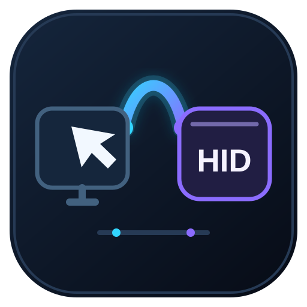

<p align="center"></p>

# Arduino Remote HID Bridge

Remote keyboard and mouse control for Windows through an Arduino Pro Micro (ATmega32U4) acting as a local USB HID device. Designed for Parsec, RustDesk and Moonlight.

## Requirements

- Arduino Pro Micro 5 V connected to the Windows PC being controlled.
- Arduino IDE with AVR board support.
- Windows PowerShell.

## Setup

> **Important: run the bridge as administrator.** The CMD launchers request elevation automatically; approve the UAC prompt, otherwise input may not reach elevated applications.

1. Download the [latest release ZIP](https://github.com/varlolwut/arduino-remote-hid-bridge/releases/latest) or clone this repository.
2. Open `firmware/RemoteHid/RemoteHid.ino` in Arduino IDE and upload it to the Pro Micro.
3. Start the appropriate CMD launcher from `windows/`.

The COM port is detected automatically. To specify it explicitly:

```cmd
windows\start-parsec-hid-bridge.cmd COM7
```

The tray icon shows the connection state and provides **Release controls** and **Exit**. If the Arduino reconnects on the same COM port, the bridge restores the connection automatically. Press **Ctrl+Alt+F12** for an emergency stop or **Ctrl+C** in the console.

## Optional OLED

A 0.91-inch SSD1306 128×32 I²C display is detected automatically at `0x3C` or `0x3D`. Connect SDA to D2, SCL to D3, GND to GND, and VCC according to the display module. It shows the link state and last input event. No display or external display library is required.

## 3D-printed enclosure

`enclosure/` contains a base and lid for a typical 34×18 mm Pro Micro. The 42×26 mm case has a micro-USB cable notch and side/lid ventilation slots. Print both parts without supports: base upright, lid with its outer face on the bed. Measure your board before printing; dimensions and clearances are adjustable in `generate_enclosure.py`.

## Supported input

- Keyboard: A–Z, 0–9, arrows, F1–F12, Space, Enter, Esc, Tab, Shift, Ctrl and Alt.
- Mouse: left, right and middle buttons, plus wheel. Cursor movement is passed through by the remote desktop software.

## Files

- `firmware/` — turns the Pro Micro into a USB keyboard and mouse; includes the optional OLED driver.
- `windows/remote-hid-bridge.ps1` — captures remote input, forwards it to the Arduino and manages the tray icon.
- `windows/start-hid-bridge.cmd` — standard mode for RustDesk; captures injected remote input.
- `windows/start-parsec-hid-bridge.cmd` — Parsec/Moonlight mode; captures virtual HID input and filters out Arduino echo.
- `enclosure/` — printable STL files and their standard-library Python generator.
- `assets/` — repository logo and social preview.
